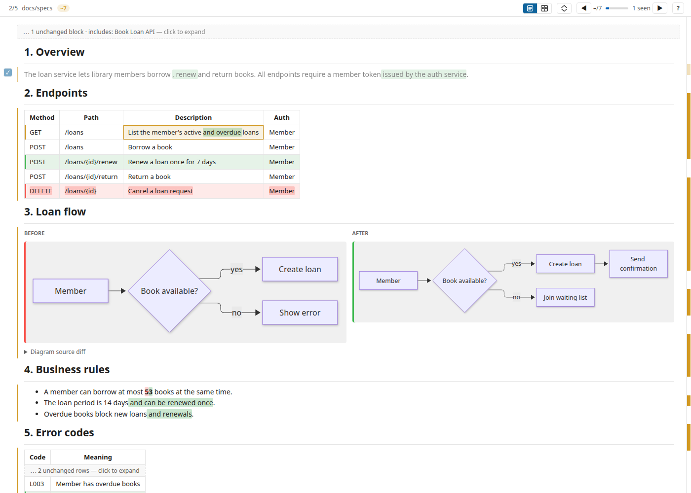
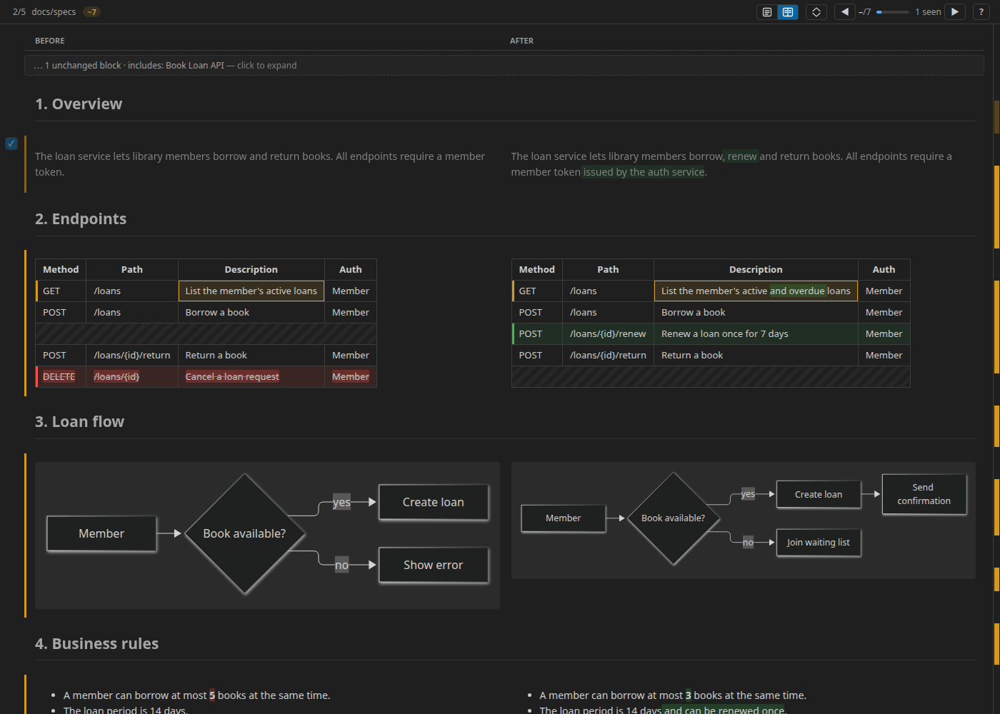
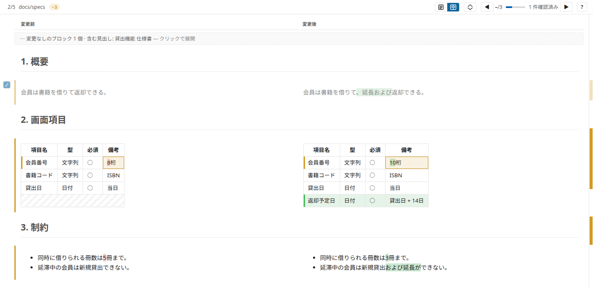

# Markdown Rendered Diff

**Review Markdown changes the way readers see them — rendered, not as raw source.**

English · [Tiếng Việt](README.vi.md) · [日本語](README.ja.md) · [简体中文](README.zh-cn.md)

Text diffs of Markdown are hard to review: a one-word change in a table row shows up as a whole changed line full of pipes, and a Mermaid edit is just code. Markdown Rendered Diff opens a **Review** tab that renders both versions and highlights what actually changed — words in paragraphs, individual cells in tables, and diagrams before/after.



## Features

- **Rendered diff** of paragraphs, lists, headings, code blocks and front matter, with word-level highlights. Works well with Japanese, Chinese and Vietnamese text (word segmentation via `Intl.Segmenter`).
- **Table-aware**: added / removed rows, and only the changed cells are highlighted. Raw HTML tables (`colspan`, `rowspan`, `colgroup`) are supported too.
- **Mermaid diagrams** are rendered side by side (before / after), with the diagram source diff one click away.
- **Math, alerts & footnotes**: KaTeX formulas (`$…$`, `$$…$$`), GitHub alerts (`> [!NOTE]`, `[!WARNING]`…) and footnotes all render in the diff.
- **Ask AI about a change** (`a`): turn one change into a ready-made prompt and send it to the clipboard, a chat view, or your own CLI — the extension never calls the network itself.
- **Export** the rendered diff to a single self-contained `.html` (open in any browser, print to PDF).
- **Unified or side-by-side** (`s`). In side-by-side mode table rows stay aligned and unchanged blocks are shown only once.
- **Collapse unchanged content** (`c`): only the changes plus one block of context are shown; collapsed groups list the headings they contain.
- **Track your progress**: mark single changes as seen (`x`) and whole files as viewed (checkbox in the sidebar, `v`). Navigation (`n` / `p`) jumps to unseen changes first.
- **Sidebar**:
  - *Changed Files* — all changed Markdown files as a tree or a list, with M / A / D badges and +/−/~ counts.
  - *Changed Sections* — an outline of the headings that contain changes; it follows your scroll position.
  - *File History* — commits that touched the current file; click one to see that commit's rendered diff.
- **Baselines** — compare against:
  - Last commit (HEAD) — everything uncommitted
  - Since your last review — only what changed after you marked the file as viewed (no commit needed)
  - As in the PR/MR — merge base with the target branch, i.e. what reviewers will see
  - Unstaged changes
  - Any commit, tag or branch
  - The clipboard (**Compare with Clipboard**), or VS Code's own Markdown diff tabs
  - Latest Claude Code turn (optional, see below)
- **Blame on hover**: rest the mouse on a block for a second to see who last changed it.
- Links between documents and `#anchors` work inside the Review tab; ↗ opens the source line in the editor.



## Getting started

1. Open a folder that is (or contains) a git repository.
2. Open the **Markdown Diff** view in the activity bar, or open a Markdown file and use one of:
   - the **Open Rendered Diff** button in the editor title bar (also shown on the built-in Markdown preview),
   - `Alt+Shift+D`,
   - right-click a `.md` file in the Explorer or in Source Control.
3. Press `?` in the Review tab for the keyboard shortcuts.

| Key | Action |
|---|---|
| `n` / `p` (`j` / `k`) | Next / previous change (unseen first) |
| `x` | Mark the selected change as seen |
| `s` | Unified ↔ side-by-side |
| `c` | Collapse ↔ show unchanged blocks |
| `v` | Mark the whole file as viewed |
| `[` / `]` | Previous / next changed file |
| `?` / `Esc` | Open / close the shortcut panel |



## Settings

| Setting | Default | Description |
|---|---|---|
| `mdReview.defaultBaseline` | `head` | Baseline used until you pick another one from the sidebar. |
| `mdReview.mrBaseBranch` | *(empty)* | Target branch for the "As in the PR/MR" baseline. Empty = detect (`origin/HEAD`, then `main`, `master`, `develop`). |
| `mdReview.renderHtml` | `true` | Render raw HTML inside Markdown (e.g. HTML tables). Always off in Restricted Mode. |
| `mdReview.allowRemoteImages` | `false` | Load `http(s)` images in the Review tab. Off by default so opening a document never contacts external servers. |

## Optional: review what Claude Code just changed

If you edit documents with [Claude Code](https://claude.com/claude-code), the **Latest Claude Code turn** baseline shows exactly what Claude changed in its last turn — separately from your own edits and earlier commits.

It is **off by default**. Run **Markdown Rendered Diff: Enable Claude Code Turn Tracking…** (or pick that baseline) and confirm. The extension then:

- copies a small Node.js script to `~/.claude/hooks/markdown-rendered-diff/`,
- adds two hooks (`UserPromptSubmit` and `PreToolUse` for `Edit|Write|MultiEdit`) to `~/.claude/settings.json`, after writing a backup next to it,
- the script saves a copy of a Markdown file right before Claude edits it (first edit per turn only) into your user cache folder (`~/.cache/markdown-rendered-diff`, `~/Library/Caches/…` on macOS, `%LOCALAPPDATA%\…` on Windows). Only the last 50 turns are kept.

The hook never blocks Claude Code (it ignores every error and always exits successfully). Run **Disable Claude Code Turn Tracking** to remove the hooks and the script; you will be asked whether to delete the saved snapshots too. Requires `node` on your `PATH`.

## Privacy and security

- No telemetry. Nothing leaves your machine; remote images are blocked unless you enable `mdReview.allowRemoteImages`.
- Document HTML is sanitized and the Review tab runs under a strict Content Security Policy: scripts inside documents never run, and links to `command:` / `file:` URIs are ignored.
- git is called with repository-defined programs disabled (fsmonitor, external diff, textconv, pager), and never in Restricted Mode.

Details and how to report a vulnerability: [SECURITY.md](SECURITY.md).

## Known limitations

- Only `.md` / `.markdown` files in local git repositories (no virtual workspaces).
- Repositories are found in the workspace folders and one level below them, plus any repository opened by VS Code's Git extension.
- Very large files (over 2 MB) ask for confirmation before rendering.
- Markdown flavour: CommonMark + tables + strikethrough + raw HTML. Plugins of the built-in preview (e.g. math) are not rendered.

## Contributing

```sh
npm install
npm run build      # bundles dist/ and copies Mermaid
npm test           # vitest
npm run package    # builds markdown-rendered-diff.vsix
```

Translations live in `l10n/src/translations.py` (run it to regenerate the bundles) and `package.nls.*.json`. `node scripts/l10n-extract.mjs` refreshes the English source bundle; the tests check that every language has every string with the same placeholders.

## License

[MIT](LICENSE). Bundled third-party packages are listed in [ThirdPartyNotices.txt](ThirdPartyNotices.txt).
