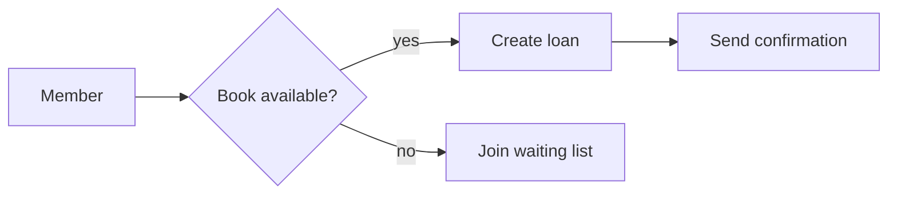

# Book Loan API

## 1. Overview

The loan service lets library members borrow, renew and return books. All endpoints require a member token issued by the auth service.

## 2. Endpoints

| Method | Path | Description | Auth |
|---|---|---|---|
| GET | /loans | List the member's active and overdue loans | Member |
| POST | /loans | Borrow a book | Member |
| POST | /loans/{id}/renew | Renew a loan once for 7 days | Member |
| POST | /loans/{id}/return | Return a book | Member |

## 3. Loan flow

## 4. Business rules

- A member can borrow at most **3** books at the same time.
- The loan period is 14 days and can be renewed once.
- Overdue books block new loans and renewals.

## 5. Error codes

| Code | Meaning |
|---|---|
| L001 | Book not found |
| L002 | Loan limit reached |
| L003 | Member has overdue books |
| L004 | Loan already renewed |

## 6. Notes

Reminders are sent by e-mail and push notification three days before the due date.

## 7. Glossary

- **Member**: a registered library user.
- **Loan**: a record that a member holds a copy of a book.
- **Renewal**: extending a loan period once.
