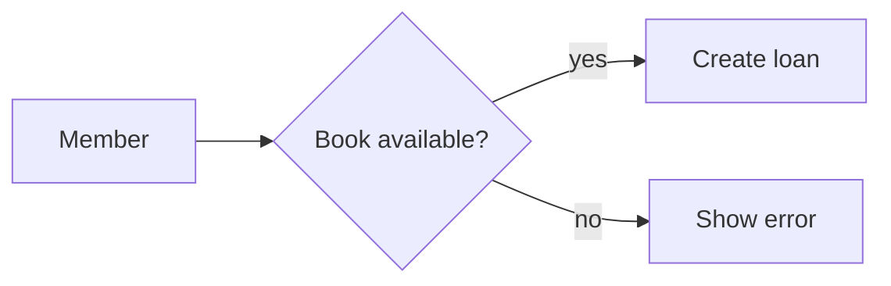

# Book Loan API

## 1. Overview

The loan service lets library members borrow and return books. All endpoints require a member token.

## 2. Endpoints

| Method | Path | Description | Auth |
|---|---|---|---|
| GET | /loans | List the member's active loans | Member |
| POST | /loans | Borrow a book | Member |
| POST | /loans/{id}/return | Return a book | Member |
| DELETE | /loans/{id} | Cancel a loan request | Member |

## 3. Loan flow

## 4. Business rules

- A member can borrow at most **5** books at the same time.
- The loan period is 14 days.
- Overdue books block new loans.

## 5. Error codes

| Code | Meaning |
|---|---|
| L001 | Book not found |
| L002 | Loan limit reached |
| L003 | Member has overdue books |

## 6. Notes

Reminders are sent by e-mail three days before the due date.

## 7. Glossary

- **Member**: a registered library user.
- **Loan**: a record that a member holds a copy of a book.
